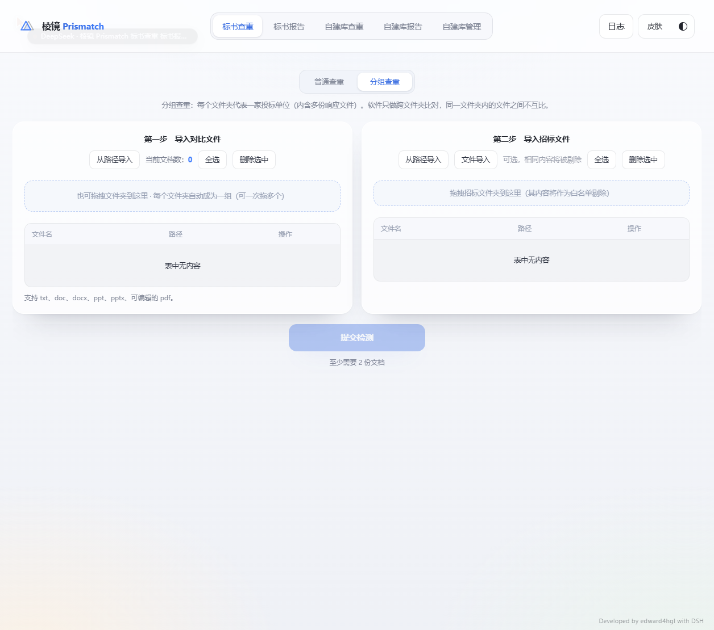

# 棱镜 Prismatch

> 本地标书查重工具。文件夹即投标单位，跨单位两两比对，找出抄袭与围标线索。
> **Developed by edward4hgl with DSH**

Windows 单机版，免安装、不联网、不上传任何文档：解析、比对、出报告全部在本机完成。



## 它做什么

- **分组查重**：一个文件夹＝一家投标单位，软件自动做 C(N,2) 组两两比对；同一文件夹内部互不比较
- **普通查重**：不分组，把导入的所有文档两两比一遍
- **招标白名单**：导入招标文件，与其相同的段落先剔除，不参与检测，避免把「官方措辞」当成抄袭
- **三种视图**：相似句子 / 相似段落 / 相似图片，双栏对照、点击跳转、上一句/下一句
- **报告**：百分比、按页输出、打印（句子 / 段落 / 全文三种版式）、导出独立 HTML、历史报告持久化
- **保留排版**：docx 转 HTML 后原样呈现（表格、加粗、标题层级都可读），不是把文字拍平成纯文本；旧版 `.doc` 与扫描件也能进同一套视图
- **扫描件 OCR**：没有文本层的 PDF 自动走 Windows 自带 OCR，逐页识别后参与比对

## 支持格式

| 类型 | 解析方式 |
|---|---|
| `.docx` | mammoth → HTML（保留表格 / 标题 / 加粗），正文另行抽取用于比对 |
| `.doc` | 装了 Word 时先转 `.docx` 再走上面的路径（排版一并保留，转换结果按内容哈希缓存）；没有 Word 时回退 OLE 复合文档 + FIB / Clx 分片表取纯文本 |
| `.pdf` | pypdf 文本层；检测到无文本层（扫描件）则用 Windows.Media.Ocr 逐页 OCR，默认最多 40 页，其余页跳过并在报告注明「已识别前 N / 共 M 页」 |
| `.pptx` / `.ppt` | python-pptx 取文本与备注 |
| `.xlsx` | openpyxl 取单元格文本 |
| `.txt` | 直接读取，自动探测编码 |
| 图片 | dHash 感知哈希，汉明距离 ≤6 判为同图 |

> `.doc` 排版还原需要本机装 Word（Office）；OCR 需要系统里存在 Windows OCR 语言包（中文简体通常已自带）。两者缺失时自动降级，不会让整个任务失败。

## 相似度算法

```
score = 0.4 × (1 - 归一化编辑距离) + 0.6 × 长度加权 token Dice
```

- 中文按字 bigram，英文按词；3-gram 倒排索引做候选召回
- 句子阈值 0.6，招标白名单阈值 0.55
- 分句符：`。！？!?` 以及中文后的 `.`；段落按空行与换行切分
- 候选召回先按 n-gram 命中率过滤（≥25% 且 ≥3 个），只对候选算精确相似度
- 编辑距离设 400 字符上限，Dice < 0.2 直接短路；文档对并行（线程池，默认 8）

## 运行（源码）

```powershell
python -m pip install -r requirements.txt
python run.py            # 默认 http://127.0.0.1:8765 ，自动打开浏览器
python run.py --port 0   # 随机端口
python run.py --no-browser
```

命令行批处理（无界面）：

```powershell
python run_check.py --group 单位A=.\标书A --group 单位B=.\标书B --tender .\招标文件 --out .\结果
```

## 打包成免安装目录版

```powershell
pyinstaller Prismatch.spec
# 产物：dist\Prismatch\Prismatch.exe
```

`launcher.py` 用 pywebview（WebView2）把本地服务包成桌面窗口：

- 端口冲突时自动换端口
- 启动后按屏幕工作区算窗口尺寸并居中（最大 1320×960，最小 1040×640）
- 关闭窗口即退出服务
- 文件夹可从资源管理器直接拖进窗口；`--port` 等参数对 exe 同样有效

## 界面

三套皮肤 × 深浅两档，右上角切换，设置会记住：

| 皮肤 | 风格 |
|---|---|
| 液态玻璃 `apple` | 毛玻璃、柔和渐变、圆角 |
| 极客终端 `geek` | 等宽字体、荧光绿、终端质感 |
| 可爱像素 `pixel` | 粗描边、粉紫配色、像素点阵底纹 |

## 目录结构

```
app/
  server.py      本地 HTTP 服务（标准库 ThreadingHTTPServer）
  engine.py      解析调度、分组、比对、进度与 ETA
  extract.py     docx/doc/pdf/pptx/xlsx/txt/图片 抽取
  wordconv.py    旧版 .doc → docx（调用本机 Word，带哈希缓存）
  ocr.py         扫描件 PDF 渲染 + 调 Windows OCR 并重组行
  ocr_win.ps1    WinRT OCR 桥（Windows PowerShell 5.1）
  text.py        归一化、分句、分词、3-gram、simhash
  report.py      独立 HTML 报告导出
  static/        前端（原生 JS，无框架、无构建）
launcher.py      桌面窗口壳（pywebview）
run.py           开发入口（起服务 + 开浏览器）
run_check.py     命令行批处理入口
vendor/          运行时用到的纯 Python 依赖
```

## 附：与市面上某商业查重软件的思路差异

市面上的同类产品多为「专业引擎 + 授权绑定」路线：文档解析交给重量级 Java 库，全文检索依赖分词词典与索引，许可证按机器码或账号绑定。这套做法准确，但部署重、迁移麻烦、离线环境不好用。

本版走的是另一条路：标准库 HTTP 服务 + 纯 Python 解析 + 字符 n-gram 召回，全部离线，解压即用。

| 环节 | 某商业产品常见做法 | 本版 |
|---|---|---|
| 解析 | 重型 Java 解析库（POI 一类） | mammoth（docx→HTML）、Word 转 docx（doc）、pypdf / OCR（pdf） |
| 索引 | 每份文档独立建索引 | 全局字符 3-gram 倒排表，内存占用低一个量级 |
| 召回 | 分词器 + 查询解析 | n-gram 命中率过滤，不依赖词典、不怕专业术语 |
| 相似度 | 阈值偏严，误报少漏报多 | 0.4×编辑距离 + 0.6×Dice，阈值 0.6（实测更贴人工判断） |
| 输出 | 模板引擎出报告 | 内置报告页 + 独立 HTML 导出 |
| 授权 | 机器码 / 联网激活 | 无，纯本地，拷走即用 |

## 已知限制

- 扫描版 PDF 的 OCR 默认只跑前 40 页（`options.ocr_max_pages` 可调），超出部分在报告里注明已识别的页数范围；封面、印章页识别质量取决于扫描清晰度
- `.doc` 的排版还原依赖本机 Word；没装 Word 时只能拿到纯文本，文本框、艺术字可能丢字
- 图片比对只看感知哈希，不做图片里的文字识别
- 报告里的排版还原依赖 `.docx` / 转换后的原始样式；PDF 与 OCR 结果是按行重组的文本，没有版式

## 说明

本项目为个人自用工具，界面文字为中文。第三方依赖遵循其各自许可证。
